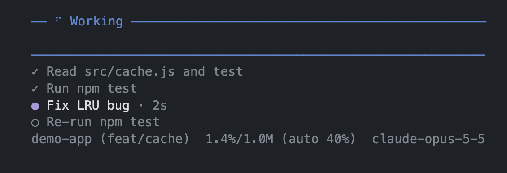
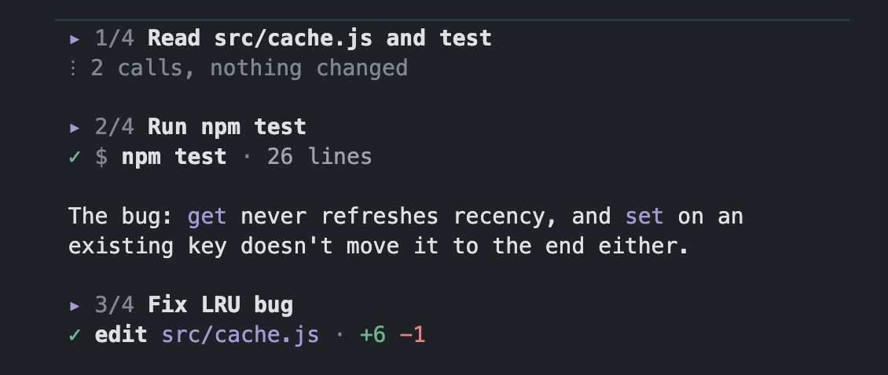

# Small extensions

Full behaviour of each small extension in this repo. The [README](../README.md#extensions) has one line for each and how to install them.

## `steps`

Source: [`extensions/steps.ts`](../extensions/steps.ts) · filter entry: `"extensions/steps.ts"`

Live checklist below the editor, set by the model through a `plan` tool; the current step shows how long it has run. A plan over 8 steps shows 8 rows around the current step, with `✓ N earlier` / `○ N more` at the edges; between prompts a paused or finished plan shows as one summary row. Each step the model starts also leaves one heading in the transcript (`▸ 2/5 Wire the parser`), drawn once and never changed, and so does the last step when the model marks the plan finished from an earlier one. `/steps off` turns it off for new sessions and this one (others on `/reload`); `/steps on` turns it back on.

## `watch`

Source: [`extensions/watch.ts`](../extensions/watch.ts) · filter entry: `"extensions/watch.ts"`

Background work the model started shows in the footer, and the model is woken once when it ends. The model registers the work with a `watch` tool: the wrapper shell's pid, and optionally a progress file (one line per finished item), an item total, and an exit file the wrapper writes `$?` to. Every 30 s the extension checks the process table (no tokens): `⏵ sweep 7/24 · last +1 23m · 2h41m` while running, then `✓ sweep exit 0`, or `✗ sweep died, no exit status` when the pid is gone (or reused) on two checks in a row with no exit file. Watches survive `/reload` and resume; `/new` starts with none. An ended watch leaves the footer on your next prompt; `watch({ label, drop: true })` removes one. It runs only `ps` and never signals a process. Design: [docs/watch/design.md](watch/design.md).

## `minimal-footer`

Source: [`extensions/minimal-footer.ts`](../extensions/minimal-footer.ts) · filter entry: `"extensions/minimal-footer.ts"`

One-line footer: `folder (branch)  ctx%/window (auto)` left, `model • thinking` right; extension statuses on a second line. `(auto)` means Pi auto-compacts at its default point; `(auto 50%)` means a setting moves that point for the current model.

## `autocompact`

Source: [`extensions/autocompact.ts`](../extensions/autocompact.ts) · filter entry: `"extensions/autocompact.ts"`

`/autocompact 50` makes Pi auto-compact the current model at 50% of its context window (whole numbers 35 to 80), in every project; `/autocompact auto` returns it to Pi's default; `/autocompact` alone shows the current threshold and where it comes from.

## `compact-tools`

Source: [`extensions/compact-tools.ts`](../extensions/compact-tools.ts) · filter entry: `"extensions/compact-tools.ts"`

One-line rows for tool calls while tool output is collapsed, with no background box. The transcript shows what was done, not what came back: a status glyph (`●` running, `✓` done, `✗` failed, `?` a passing `;` or newline sequence without `set -e`, whose earlier statements may have failed unseen), what ran, and facts such as `40 lines · 4.2s`. `bash` drops a leading `cd` (the directory is named, as `in web`, only when it differs from the command row above; a row too wide for the terminal keeps the directory's last folders, as `in …/pi-tui/dist`), `set -e`, `2>&1` and a closing `| tail -N` or `| head -N` from the command and cuts a long one in the middle (at its end when only a few characters over); a command of several lines shows its first with `⏎N` for the N lines after it; `edit` shows `+added -removed`; `read` and `write` show a short path and a line count, and an image `read` shows `image`; a tool with no renderer of its own shows its name, its arguments and a line count. Control characters in commands, paths and output are dropped. Only a failure shows output: a failed command keeps its end from the first error-like line in its last 20 lines, and at least 5; an end longer than 8 lines shows only its error-like lines and the values of failed comparisons (`expected: …`), each once, and one line takes two rows at most; a line that reports a pass (`✔ …`, `fail 0`) is not error-like. Error-like lines are red, and `file:line` references are links where the terminal supports them. A duration of 30s or more is yellow. While the agent works, a call shows only in a three-line area above the editor, the running one with its elapsed time and the end of its output. A row enters the transcript once the next step shows what became of it. Followed by another step, a call known to change nothing (`read`, `rg`, `git log`, a passing `npm test`) keeps no line, and those that open a stretch of work are one count (`⋮ 5 calls, nothing changed`); any command the extension does not know keeps its line, as does one with `--fix`, a background `&` part that may change something, or an `fd -x`/`--exec`, and so does the first passing run of a command that failed earlier. Writing to a file under `/tmp` counts as changing nothing, unless the work is done there. A step followed by text keeps its line, and a line once drawn is never taken back, so a row that has scrolled away does not change and Pi does not have to repaint the screen. Failures, writes, and edits show as soon as the call ends and stay, and a call made before one of them, or before a tool that draws its own row, in the same message shows with it, running or not; a failed command still on screen shrinks to `✗ … · passed later` once the same command passes, also behind a runner such as `uv run` or as one command of a passing `&&` chain (one that has scrolled away stays as drawn); a passing run that ends in a pipe does not count, since the shell reports only the last program's exit code. When the agent stops, the area becomes one line that sums up the run: `✗ open: npm run lint · exit 1 · 2 files changed · 6 calls · 1m 12s`, naming the newest failure still open, cut in the middle so a file name stays; calls made inside another tool, such as a codemode script, are not counted, and a `read` of a missing file or a search (`rg`, `grep`, `git grep`) that only found nothing (exit 1, no output) leaves nothing open. Other tools keep their own lines behind the glyph; the line of a tool that draws its own shell, such as a `plan` step heading, stands above the first row of its message, wherever in the message the tool was called. Failed `write` and `edit` calls and expanded rows (`ctrl+o`) show everything.

## `hide-thinking-label`

Source: [`extensions/hide-thinking-label.ts`](../extensions/hide-thinking-label.ts) · filter entry: `"extensions/hide-thinking-label.ts"`

Removes the `Thinking...` label, and the blank lines around it, that Pi shows for a hidden thinking block.
